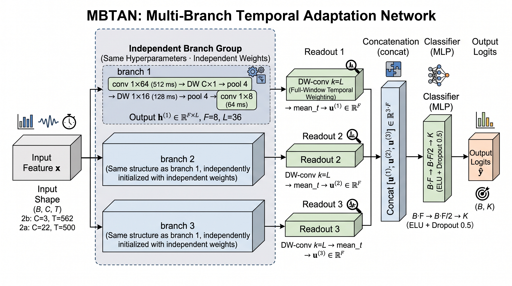

# MBTAN: A Multi-Branch Temporal Adaptation Network for Cross-Subject Motor Imagery EEG

## Abstract

Cross-subject motor imagery (MI) EEG decoding removes the need for per-user calibration and is therefore central to practical brain–computer interfaces. Yet the field lacks a reliable picture of its true cross-subject performance (leave-one-subject-out, LOSO): widely compared cross-subject methods are mostly evaluated under within-subject cross-session settings or assume labeled target-subject data, so their reported values are mutually incomparable, while continued architectural elaboration has not produced reproducible cross-subject gains. Improvement therefore cannot rely on a single direction: it requires both clarifying the biases introduced by distribution shift and evaluation differences, and identifying under controlled conditions which components of model structure and adaptation are actually effective. Accordingly, we rebuild the evaluation on a single pipeline: (1) nine model families (including official-code re-runs) are re-measured and their evaluation protocols are characterized along four orthogonal fields with the resulting setting gaps quantified; (2) a compact multi-branch encoder, MBTAN (4,142 parameters), is proposed as a controlled carrier for separating structural from capacity effects; and (3) four adaptation mechanisms are characterized under the same protocol. The within-subject cross-session vs. transductive cross-subject LOSO gap reaches 7.6–25.3 points and even inverts method rankings. On BCI Competition IV-2b, MBTAN reaches the upper edge of the 74.0–75.8% convergence band with 75.80 ± 0.19% (5 seeds) and is statistically indistinguishable from the 1,698-parameter EEGNet (75.56%); its branch ablations yield an interpretable structural conclusion: concentrating capacity in a single branch is significantly harmful (−0.88, p = 0.039), whereas multi-scale pooling, band decomposition, and cross-family fusion bring no gains.

## Model Architecture



## Citation

If you find this work useful, please cite it as:

```bibtex
@article{liu2026mbtan,
  title   = {MBTAN: A Multi-Branch Temporal Adaptation Network for Cross-Subject Motor Imagery EEG},
  author  = {Liu, Darong and Woo, Chaw Seng and Saw, Shier Nee and He, Yiqing},
  journal = {Journal of King Saud University -- Computer and Information Sciences},
  year    = {2026},
  note    = {Manuscript under review}
}
```
